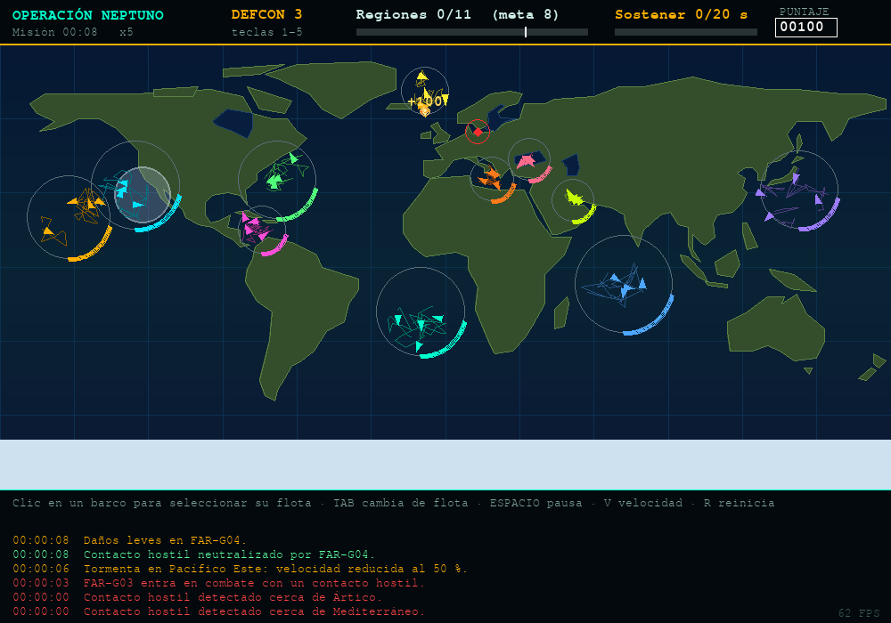

# Operación Neptuno 2D

Mini-juego de estrategia naval en **Python + pygame**, desarrollado con IA como copiloto (vibecoding guiado, KODIGO · AI For Devs Jr. 3).


## Cómo ejecutarlo

```bash
pip install -r requirements.txt
python neptuno.py
```

Modo de prueba automática (sin ventana, genera `captura.png`): `python neptuno.py --test`

## Objetivo y controles

Controla **8 de las 11 regiones** estratégicas durante **20 s**. Cada flota (4 grupos de ataque) patrulla su región; aparecen contactos hostiles, tormentas y fallos mecánicos.

| Acción | Control |
|---|---|
| Seleccionar flota | Clic en un barco / `TAB` |
| Mover flota | Clic en el océano (ruta con A*) |
| Volver a base | `B` |
| DEFCON 1–5 | `1`–`5` |
| Velocidad x0.5/1/2/5 | `V` |
| Pausa / Reiniciar / Deseleccionar | `ESPACIO` / `R` / `ESC` |

## Estructura del código (`neptuno.py`)

- `Mundo`: máscara tierra/agua dibujada con polígonos lon/lat, rejilla de navegación y **A\*** con suavizado por línea de visión.
- `Grupo` / `Enemigo`: entidades con patrulla, tormentas (-50 % velocidad), fallos y combate.
- `Juego`: simulación (eventos aleatorios, control de regiones, victoria), entrada, dibujo y HUD.

---

## 1. Evidencia de vibecoding (prompts reales)

Estos son los prompts que usé, en orden, con Claude como copiloto.

**Prompt 1 – Generar el juego**
> "Ayúdame con esto, esa es mi tarea, solo créala en Python." *(adjunté el enunciado de la tarea y la descripción de mi idea "Operación Neptuno")*
- *Qué pedí:* que la IA convirtiera mi idea en un mini-juego 2D en Python con pygame y armara el README según la rúbrica.
- *Resultado:* `neptuno.py` con mapa mundial, 11 flotas de 4 grupos, rutas con A*, enemigos, tormentas, fallos y DEFCON.

**Prompt 2 – Llevarlo a mi entorno**
> "Ok, pero lo haré en VS Code, ayúdame con eso, crea la carpeta del proyecto para subirlo a GitHub."
- *Qué pedí:* una carpeta lista para abrir en VS Code (`requirements.txt`, `.gitignore`, repositorio git).
- *Por qué ajusté:* el primer resultado era solo el código; necesitaba trabajar en mi editor local y entregar como repositorio.

**Prompt 3 – Automatizar la subida**
> "Dame el prompt para que la extensión lo suba a GitHub."
- *Qué pedí:* un prompt para que una extensión/agente hiciera la subida por mí.
- *Resultado:* un prompt de 7 pasos (ver prompt 4).

**Prompt 4 – Prompt estructurado para subir a GitHub**
> "Sube este proyecto a GitHub. Haz lo siguiente paso a paso: 1. Verifica que estoy dentro de la carpeta del proyecto… 3. Revisa `git status` y confirma que .gitignore excluye `__pycache__/`, `.venv/` y `.vscode/`… 6. Si `gh` no está instalado o no he iniciado sesión, no intentes autenticarte por tu cuenta ni me pidas mi contraseña o token… Antes de ejecutar `git push` o crear el repositorio, muéstrame el comando y espera mi confirmación."
- *Qué pedí:* pasos verificables, una regla de seguridad (no compartir credenciales) y confirmación antes de publicar.
- *Por qué tuve que ajustar:* el agente trabajaba en la nube y **no tenía acceso a mi carpeta local**, así que el plan con `gh` no funcionó. Cambié de estrategia: la IA creó el repositorio desde el navegador y yo arrastré los archivos a GitHub.

**Prompt 5 – Mejora visual (iteración)**
> "Haz lo mejor, que quede bonito y funcione."
- *Qué pedí:* una mejora visible al juego; la IA propuso opciones y yo le dejé elegir.
- *Por qué:* al revisar la tarea contra la rúbrica vi que me faltaba una iteración pedida por mí. Detalle en la sección 2.

## 2. Iteración y mejora

**Iteración 1 – Explosiones y puntaje (pedida por mí, prompt 5)**

| Antes | Después |
|---|---|
| Al neutralizar un enemigo salían 24 puntitos naranjas casi invisibles. | Explosión con 40 chispas de 3 colores que frenan, un **destello** y una **onda expansiva**. |
| No había puntaje; solo se veía "Neutralizados" al final. | **PUNTAJE** en el HUD: +100 por enemigo, +250 por región capturada, con texto "+100" flotante y el marcador que brilla al subir. |
| La pantalla final no mostraba puntaje. | Pantalla final con **PUNTAJE FINAL**. |

Código: `Juego.explosion()`, nuevo `Juego.sumar_puntos()`, dibujo de `ondas`/`flotantes` en `Juego.dibujar()` y marcador en `Juego.dibujar_hud()`.



**Iteración 2 – Balance (ajuste que hizo la IA y verifiqué)**
- Al generar el juego, la IA detectó que el control de regiones llegaba a 100 % en ~16 s y la partida se ganaba casi sin jugar. Bajó el ritmo de captura de `6.0` a `2.5` por segundo (`actualizar_regiones`).
- *Impacto:* en la prueba automática la victoria pasó de **t = 37 s a t = 60 s** de simulación.

## 3. Validación del resultado

- **Prueba automática** (`python neptuno.py --test`): corre 1 500 fotogramas sin ventana (driver SDL `dummy`), da órdenes a 3 flotas, intenta enviar una a tierra firme (debe rechazarse) y guarda una captura. Tras la iteración 1 añadí una verificación: el puntaje debe ser al menos 100 × enemigos neutralizados.
- **Prueba desde GitHub:** se clonó el repositorio en un entorno limpio, se instaló `requirements.txt` y la prueba terminó con `PRUEBA OK` y "MISIÓN CUMPLIDA".
- **Prueba manual:** jugar, mover flotas, cambiar DEFCON, pausar y reiniciar.
- **Errores y limitaciones encontrados:**
  1. El README mostraba una imagen rota (`docs/captura.png` no estaba en el repositorio). Se agregó la carpeta `docs/`.
  2. Al subir por la web subí también el `.zip` del proyecto por error; lo quité antes del commit porque duplicaba el código.
  3. El balance inicial era demasiado fácil (iteración 2).
  4. El mapa usa polígonos aproximados: estrechos como Panamá no son navegables y el Golfo Pérsico es muy pequeño a esta resolución.

## 4. Reflexión final

<!-- Escribe aquí con tus propias palabras, 2-3 líneas por punto. -->

**¿Qué aprendí usando IA para programar?**

_(pendiente)_

**Ventajas y límites del vibecoding**

_(pendiente)_

**¿Qué partes del código comprendo y cuáles debo reforzar?**

_(pendiente)_
