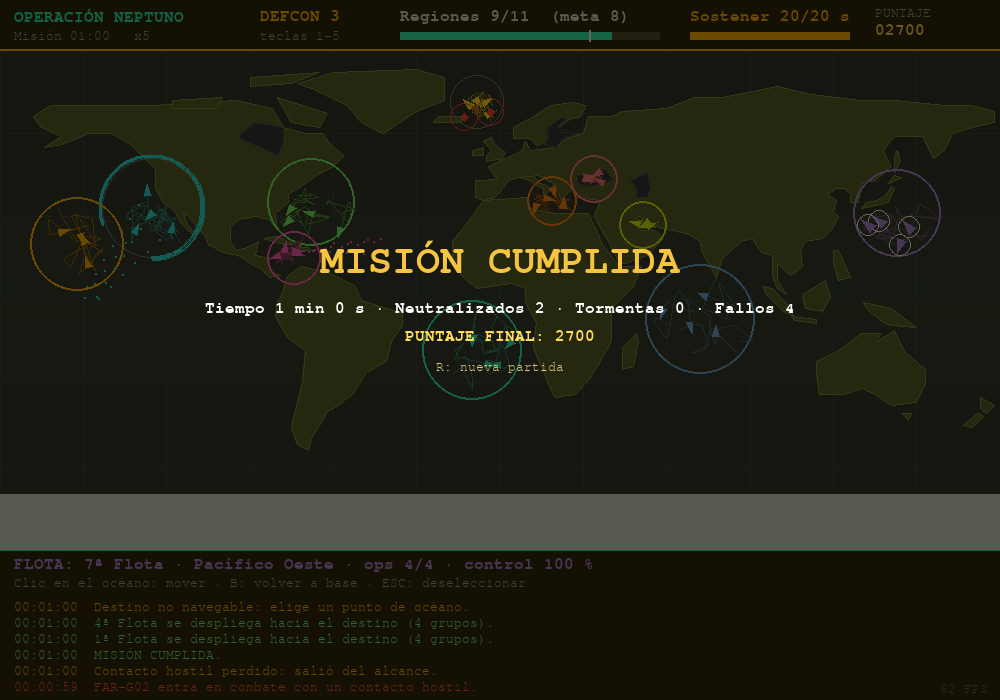

# Operación Neptuno 2D

Mini-juego de estrategia naval en **Python + pygame**, desarrollado con IA como copiloto (vibecoding guiado, KODIGO · AI For Devs Jr. 3).



## Cómo ejecutarlo

```bash
pip install -r requirements.txt
python neptuno.py
```

Modo de prueba automática (sin ventana, genera `captura.png`): `python neptuno.py --test`

## Objetivo y controles

Controla **8 de las 11 regiones** estratégicas durante **20 s**. Cada flota (4 grupos de ataque) patrulla su región; aparecen contactos hostiles, tormentas y fallos mecánicos.

| Acción | Control |
|---|---|
| Seleccionar flota | Clic en un barco / `TAB` |
| Mover flota | Clic en el océano (ruta con A*) |
| Volver a base | `B` |
| DEFCON 1–5 | `1`–`5` |
| Velocidad x0.5/1/2/5 | `V` |
| Pausa / Reiniciar / Deseleccionar | `ESPACIO` / `R` / `ESC` |

## Estructura del código (`neptuno.py`)

- `Mundo`: máscara tierra/agua dibujada con polígonos lon/lat, rejilla de navegación y **A\*** con suavizado por línea de visión.
- `Grupo` / `Enemigo`: entidades con patrulla, tormentas (-50 % velocidad), fallos y combate.
- `Juego`: simulación (eventos aleatorios, control de regiones, victoria), entrada, dibujo y HUD.

---

## 1. Evidencia de vibecoding (prompts)

> **Nota:** reemplaza/ajusta estos textos con tus prompts reales y tu propia redacción antes de entregar.

**Prompt 1 – Idea base**
> "Crea una simulación de flotas navales en Python con pygame: mapa del mundo, 11 flotas con grupos de barcos que patrullan, contactos hostiles y un objetivo de controlar regiones."
- *Qué se pidió:* la estructura inicial del juego.
- *Por qué:* partir de un objetivo claro y verificable (mapa + entidades + condición de victoria).

**Prompt 2 – Navegación**
> "Los barcos atraviesan tierra. Haz que al hacer clic en el océano la flota calcule una ruta evitando continentes (A*)."
- *Qué se pidió:* pathfinding sobre una rejilla de agua.
- *Por qué se refinó:* el primer enfoque (línea recta) fallaba con continentes; se pidió A* y suavizado de la ruta.

**Prompt 3 – Eventos y dificultad**
> "Añade tormentas, fallos mecánicos y niveles DEFCON que cambien la frecuencia de enemigos."
- *Qué se pidió:* eventos aleatorios y dificultad ajustable.
- *Por qué:* hacer el juego rejugable y con decisiones para el jugador.

**Prompt 4 – Balance (iteración)**
> "La victoria llega demasiado rápido, ajusta el balance."
- *Qué se pidió:* reducir la velocidad de captura de regiones.

## 2. Iteración y mejora

- **Mejora solicitada:** el control de regiones subía a 100 % en ~16 s de simulación y la partida se ganaba casi sin jugar. Se bajó el ritmo de captura de `6.0` a `2.5` por segundo (`actualizar_regiones`).
- **Impacto visible:** en la prueba automática la victoria pasó de **t = 37 s a t = 60 s** de simulación.

## 3. Validación del resultado

- **Prueba automática** (`python neptuno.py --test`): corre 1 500 fotogramas sin ventana (driver SDL `dummy`), da órdenes de movimiento a 3 flotas, intenta enviar una a tierra firme y guarda una captura.
- **Prueba manual:** jugar, mover flotas, cambiar DEFCON, pausar, reiniciar.
- **Ajuste / limitación detectada:** (1) el balance era demasiado fácil (ver sección 2). (2) El mapa usa polígonos aproximados: estrechos como Panamá no son navegables, por lo que hay que rodear el continente, y el Golfo Pérsico es muy pequeño a esta resolución.

## 4. Reflexión final

> **Escríbela con tus palabras.** Puntos de partida:

- **Qué aprendí:** que un prompt claro y por etapas da mejor código que uno largo y vago; y a leer el código generado para entender cómo funciona A*.
- **Ventajas del vibecoding:** rapidez para tener un prototipo y para explorar ideas.
- **Límites:** la IA puede producir lógica incorrecta o poco balanceada; hay que probar y corregir.
- **Lo que comprendo / debo reforzar:** *(completa tras revisar el código)* p. ej. entiendo el bucle principal y las clases; debo reforzar A* y la proyección lon/lat → píxeles.
